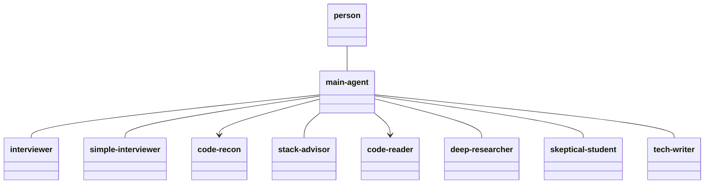
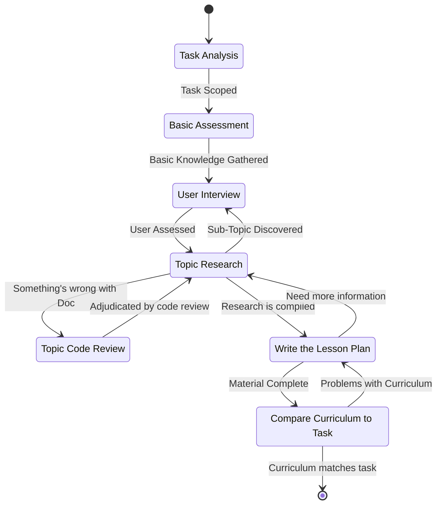

# Overall

This is a command to establish a learning plan to bridge the gap from what they know to what they don't. The learning plan will consist of documentation and an accompanying practical portion to complete for each lesson.

# The Process

The following Class diagram shows how each of the agents relate. 

Lines without arrows represent a persistent relationship — the same agent instance stays addressable across multiple rounds, the way a person has an ongoing conversation with the main agent rather than a single exchange. This implicitly means that the exchange between the main agent and the sub-agents is two-way.  Sub-agents should be allowed to pass questions and information among each other for clarification. 

Lines with a directional arrow indicate a one-shot subagent: the main agent spawns it, it completes a single task and reports its findings back, and that instance is not addressed again.

The process is diagrammed here in the following state chart:

## State table

Each agent below starts with its state's skill already loaded, so starting or resuming the agent is all it takes to put it to work.

| State | Agent | Skill | Instance |
|---|---|---|---|
| Task Analysis | `code-recon` (Discovery Mode) or `stack-advisor` (Proposal Mode) | `discover-stack` / `propose-stack` | new |
| Basic Assessment | `simple-interviewer` | `basic-assessment` | new |
| User Interview | `interviewer` | `user-interview` | persistent |
| Topic Research | `deep-researcher` | `topic-research` | persistent |
| Topic Code Review | `code-reader` | `topic-code-review` | new each time |
| Write the Lesson Plan | `tech-writer` | `write-lesson-plan` | persistent |
| Compare Curriculum to Task | `skeptical-student` | `compare-curriculum` | persistent |

**Persistent** means you start the agent the first time it's needed and resume that same instance every time after that, whether it's entering its state again or answering a question.

## Running the process

Every agent ends each of its turns with one marker. Act on the marker as follows:

1. **`ASK USER:`** Show the text to the user as `From <name> Agent:` followed by the agent's exact words. Send the user's reply, exactly as written, to the same agent instance.
2. **`ASK <agent>:`** Add the asking agent to the end of your list of waiting askers. Then send the question, exactly as written, to the named agent: resume it if it exists, or start it if it doesn't. Handle that agent's turns with these same steps.
3. **`ANSWER:`** Remove the last agent from your list of waiting askers, and send it the answer exactly as written. That agent continues from where it stopped.
4. **`DONE → <state>:`** Move to that state. Start or resume its agent as the state table says, and give it the output exactly as written, as its input.
5. **`DONE → END:`** Show the output to the user as `From <name> Agent:` followed by the agent's exact words. The process is complete.
6. **A turn with no marker:** send the agent a message saying its turn had no marker, so it can finish the turn with one.

A question and its answer are a round trip: the process moves into the answering agent's state, then returns to the asker's state.

## Rules for Main Agent

**Your job.** You run the process in the state chart. Begin with Task Analysis, below. After that, for each state, start or resume the agent named in the state table, then follow *Running the process* until the process reaches `END`. Every content decision belongs to the agents.

**Hard rules:**
1. **Pass every message on exactly as written.** This covers each agent's output, the user's replies, and each step's output. When showing agent output to the user, write `From <name> Agent:` followed by the agent's exact words. That line is the whole message.
2. **Enter every state the agents send you to.** Treat every state as required, even one whose topic has come up before. Each state's agent does work the earlier states did not.
3. **Send every question to the agent the `ASK` marker names.** That agent owns the answer. Your part is delivering the question and bringing the answer back.
4. **Leave all content writing to the agents.** Your file operations are the ones in *Preparing source*, below.

# Task Analysis

## Basics
- Performed by the main Agent, which determines the mode and starts `code-recon` or `stack-advisor`.

## The Process

The main agent will establish what the user is trying to achieve. It might be something like:

- Being able to understand a codebase.
- Fixing a bug in an existing codebase.
- Building a new application from scratch.
- Using a similar but different tool in a codebase.
- Learning a new software tool.

The user will form their request as a prompt entered as a parameter to this command. If the user doesn't provide a prompt, ask them what they're looking to do. The user's goal is referred to as the **project**.

**First, determine the mode:**

- If the user references existing code (a repo, a file path, a specific bug, "help me understand/fix X"), this is **Discovery Mode**. Start `code-recon`, which runs the `discover-stack` skill, and give it the user's request.
- If the user describes a goal with no existing code ("I want to build X"), this is **Proposal Mode**. Start `stack-advisor`, which runs the `propose-stack` skill, and give it the user's request.
- If the request is ambiguous, ask the user directly which situation applies before proceeding.

Both skills produce the same output: a **Tech Stack List**, the set of subjects, concepts, Topics, and tools that make up the system, i.e. everything someone would need to know in order to work on it. 

## Output

The output of the initial assessment should be the **Tech Stack list.**  This is the list of subject/concept/topic/tools that are used in the project.  Each subject/concept/topic/tool should be listed, followed by a brief paragraph describing how that tool is used in the project.

# Preparing source

Before starting `code-reader`, prepare the source named in `deep-researcher`'s question. Before starting `skeptical-student`, prepare the user's project source. Do both as follows:

In order to do this, first materialize the real source as plain files somewhere the agent can read them directly — for a third-party subject/concept/topic/tool, clone its repository to the home directory; for the user's own project, check out the correct branch into a worktree, since a mid-branch git ref is not something these agents can resolve themselves. Then have the `code-reader` agent read through it. Neither `code-reader` nor the `skeptical-student` agent used in *Compare Curriculum to Task* has shell or git access — both can only read files placed directly in front of them. Any state that needs either agent to check real source must complete this preparation first; neither agent can be told to "check the repo" and be expected to locate or check it out on its own.
