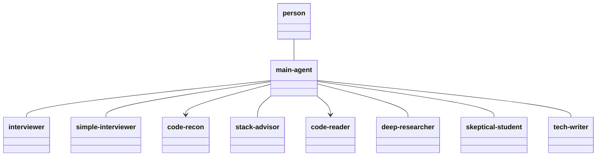
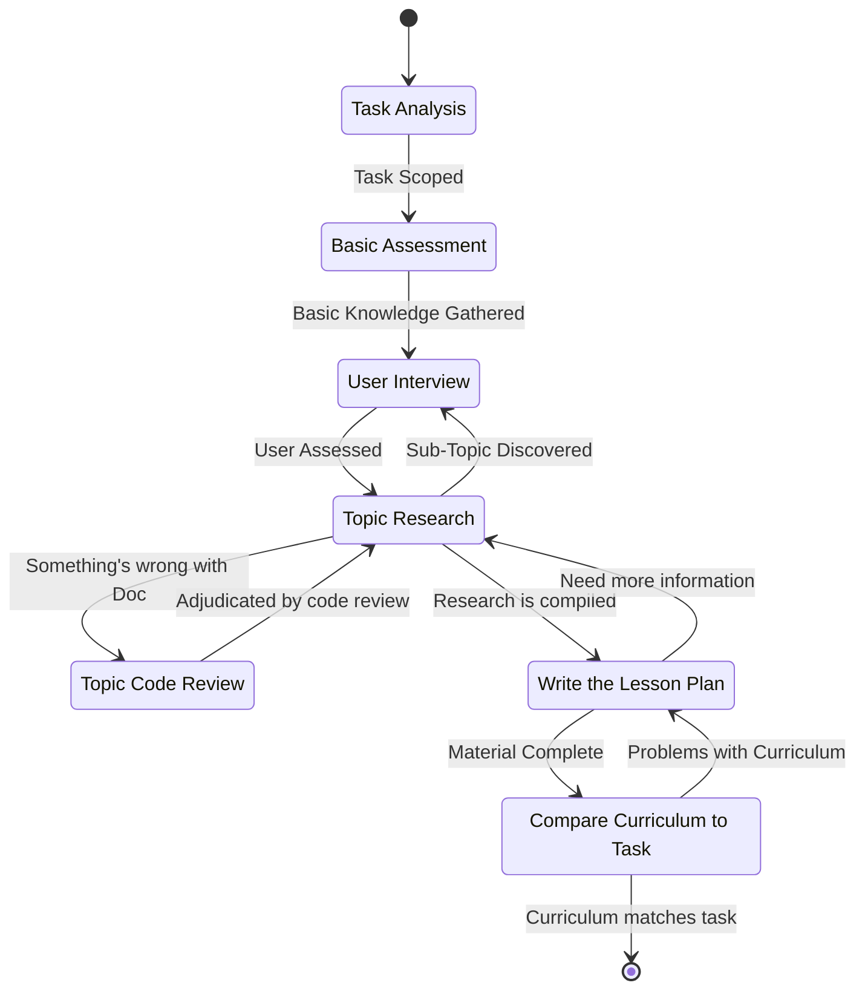

# Overall

This is a command to establish a learning plan to bridge the gap from what they know to what they don't. The learning plan will consist of documentation and an accompanying practical portion to complete for each lesson.

# The Process

The following Class diagram shows how each of the agents relate. 

Lines without arrows represent a persistent relationship — the same agent instance stays addressable across multiple rounds, the way a person has an ongoing conversation with the main agent rather than a single exchange. This implicitly means that the exchange between the main agent and the sub-agents is two-way.  Sub-agents should be allowed to pass questions and information among each other for clarification. 

Lines with a directional arrow indicate a one-shot subagent: the main agent spawns it, it completes a single task and reports its findings back, and that instance is not addressed again.



The process is diagrammed here in the following state chart:



## State table

Each agent below starts with its state's skill already loaded, so starting or resuming the agent is all it takes to put it to work. When you start an agent, give it the path of the run folder. Each agent reads its own input files from the run folder and writes its own output file there. Each agent also appends its reasoning to `notes.md` in the run folder, a log that no agent reads unless a message tells it to.

| # | State | Agent | Skill | Instance | Output file |
|---|---|---|---|---|---|
| 01 | Task Analysis | `code-recon` (Discovery Mode) or `stack-advisor` (Proposal Mode) | `discover-stack` / `propose-stack` | new | `01-tech-stack.md` |
| 02 | Basic Assessment | `simple-interviewer` | `basic-assessment` | new | `02-basic-assessment.md` |
| 03 | User Interview | `interviewer` | `user-interview` | persistent | `03-interview.md` |
| 04 | Topic Research | `deep-researcher` | `topic-research` | persistent | `04-curriculum.md` |
| 05 | Topic Code Review | `code-reader` | `topic-code-review` | new each time | `05-code-review-<topic>.md` (optional: most runs have none) |
| 06 | Write the Lesson Plan | `tech-writer` | `write-lesson-plan` | persistent | `06-lesson-plan-r<N>.md`, one per round |
| 07 | Compare Curriculum to Task | `skeptical-student` | `compare-curriculum` | persistent | `07-review-r<N>.md`, one per round |

**Persistent** means you start the agent the first time it's needed in this run and resume that same instance every time after that, whether it's entering its state again or answering a question. An agent started partway through a run picks up its step from the files in the run folder.

## Running the process

Every agent ends each of its turns with one marker. Act on the marker as follows. Append every message you handle to `transcript.md`, as described in *The transcript*, before acting on it.

1. **`ASK USER:`** Show the text to the user as `From <name> Agent:` followed by the agent's exact words. Send the user's reply, exactly as written, to the same agent instance.
2. **`ASK <agent>:`** Add the asking agent to the end of your list of waiting askers. Then send the question, exactly as written, to the named agent, together with the path of the run folder: resume the agent if it exists, or start it if it doesn't. Handle that agent's turns with these same steps.
3. **`ANSWER: <path>`** Check the file (see step 7). Remove the last agent from your list of waiting askers, and send it the whole `ANSWER` message exactly as written. That agent reads the file and continues from where it stopped.
4. **`DONE → <state>: <path>`** Check the file (see step 7). Move to that state. Start or resume its agent as the state table says, and send it the run folder path and the whole `DONE` message exactly as written.
5. **`DONE → END: <path>`** Check the file (see step 7). Show the message to the user as `From <name> Agent:` followed by the agent's exact words, then give the path of the run folder. The process is complete.
6. **A turn with no marker:** send the agent a message saying its turn had no marker, so it can finish the turn with one.
7. **Checking the file:** before passing on an `ANSWER` or `DONE`, confirm that the file at its path exists. If it exists, add it to the Files list in `run.md` as produced by this run, unless it's already listed. If it doesn't exist, send the agent a message saying the file is missing, so it can write the file and send its marker again.

A question and its answer are a round trip: the process moves into the answering agent's state, then returns to the asker's state.

In `--only` mode, the run ends when the starting step's agent sends `DONE`. Check the file, show the message to the user as `From <name> Agent:` followed by the agent's exact words, give the path of the run folder, and stop there without entering the next state.

## Rules for Main Agent

**Your job.** You run the process in the state chart. Begin with *Starting a run*, below. After that, for each state, start or resume the agent named in the state table, then follow *Running the process* until the process reaches `END`. Every content decision belongs to the agents.

**Hard rules:**
1. **Pass every message on exactly as written.** This covers each agent's output, the user's replies, and each step's output. When showing agent output to the user, write `From <name> Agent:` followed by the agent's exact words. That line is the whole message.
2. **Enter every state the agents send you to.** Treat every state as required, even one whose topic has come up before. Each state's agent does work the earlier states did not.
3. **Send every question to the agent the `ASK` marker names.** That agent owns the answer. Your part is delivering the question and bringing the answer back.
4. **Leave all content writing to the agents.** Your file operations are setting up the run folder, keeping `run.md` up to date, appending exact messages to `transcript.md`, and *Preparing source*.
5. **Start Task Analysis only after `run.md` records a Goal.**

# Starting a run

The user's arguments:

```
$ARGUMENTS
```

Every run gets its own folder under `./runs/`, in the directory Claude was launched from. Set it up as follows.

1. **Read the mode from the arguments:**
   - `--from <step> <source-run> [notes]`: start at `<step>` and run to the end.
   - `--only <step> <source-run> [notes]`: run `<step>` alone, then stop.
   - Anything else is a **full** run, and the arguments are the user's request. A full run shall start from a goal: what the user wants to be able to do or have when the process ends, such as fixing a named bug, building a named thing, or changing a named behavior. Test: complete the sentence "The user wants to ___" using only the user's own words. A named repo, branch, file or tool is a target, and "understand" or "learn" with no outcome stated is also a target, so neither completes the sentence. When the arguments are empty, or the sentence can't be completed, ask the user "What are you trying to do with `<target>`?" (or "What are you looking to do?" when there is no target) and repeat until it can be completed. Record the completed sentence as the goal.
2. **For `--from` and `--only`, check the step and the source run:**
   - `<step>` is one of these skill names, each with the number of its output file: `discover-stack` (01), `propose-stack` (01), `basic-assessment` (02), `user-interview` (03), `topic-research` (04), `write-lesson-plan` (06), `compare-curriculum` (07).
   - When `<step>` is `topic-code-review`, tell the user that code review only happens when `deep-researcher` asks for it, so it can't be a starting step. To tune it, they can run `--only topic-research` on a request where the documentation is known to be wrong. Stop there, without creating a run folder.
   - When `<step>` is any other name that isn't in the list, tell the user the valid step names and stop there.
   - `<source-run>` is a folder under `./runs/`, or a path to one. It contains a `run.md`. When it can't be found, tell the user and stop there.
3. **Create `./runs/` if it doesn't exist.** At the same time, write `./runs/.gitignore` containing the single line `*`. This keeps runs out of git in any repo, without touching the repo's own `.gitignore`.
4. **Create the run folder,** named `<YYYY-MM-DD>-<slug>`: today's date, then three to five lowercase words from the goal (or, for --from and --only, the request) joined by hyphens. When a folder with that name exists, add `-2`, `-3` and so on.
5. **For `--from` and `--only`, copy files from the source run:** every numbered file whose number is *below* the starting step's number. For example, a start at `topic-research` (04) copies the `01-`, `02-` and `03-` files. Copy nothing else, so every other file in the new folder comes from this run.
6. **Write `run.md`:**

   ```
   # Run: <run folder name>

   - **Request:** <the user's request, word for word; for --from and --only, copied from the source run's run.md>
   - **Goal:** <the completed sentence "The user wants to ___", in the user's words; for --from and --only, copied from the source run's run.md>
   - **Mode:** full | from <step> | only <step>
   - **Source run:** <source run folder, or "none">
   - **Notes:** <the notes from the arguments, word for word, or "none">

   ## Files

   - `<file>`: copied from `<source run>`
   ```

   List every copied file. Files this run produces are added as they arrive (see *Running the process*).
7. **Create `transcript.md`** containing only the heading `# Transcript: <run folder name>`. Create `notes.md` containing only the heading `# Notes: <run folder name>`. Neither file is copied from the source run.
8. **Start the process:**
   - **Full run:** begin at *Task Analysis*, below.
   - **`--from` or `--only`:** start the agent for `<step>` from the state table, and send it the path of the run folder. For `discover-stack` start `code-recon`, and for `propose-stack` start `stack-advisor`.

## The transcript

`transcript.md` is a word-for-word log of every message you handle, in order. For each message, append:

```
### <n>. <sender> → <receiver> (<marker>)

<the message, exactly as written>
```

The sender or receiver is an agent's name or `user`. The user's replies are logged with the marker `reply`. Number the entries 1, 2, 3 and so on. Only append to the file; leave earlier entries exactly as they are.

# Task Analysis

## Basics
- Performed by the main Agent, which determines the mode and starts `code-recon` or `stack-advisor`.

## The Process

The main agent will establish what the user is trying to achieve. It might be something like:

- Being able to understand a codebase.
- Fixing a bug in an existing codebase.
- Building a new application from scratch.
- Using a similar but different tool in a codebase.
- Learning a new software tool.

The user's goal, established in *Starting a run*, is referred to as the **project**.

**First, determine the mode:**

- If the user references existing code (a repo, a file path, a specific bug, "help me understand/fix X"), this is **Discovery Mode**. Start `code-recon`, which runs the `discover-stack` skill, and give it the path of the run folder.
- If the user describes a goal with no existing code ("I want to build X"), this is **Proposal Mode**. Start `stack-advisor`, which runs the `propose-stack` skill, and give it the path of the run folder.
- If the request is ambiguous, ask the user directly which situation applies before proceeding.

Both skills produce the same output: a **Tech Stack List**, the set of subjects, concepts, Topics, and tools that make up the system, i.e. everything someone would need to know in order to work on it. 

## Output

The output of the initial assessment should be the **Tech Stack list.**  This is the list of subject/concept/topic/tools that are used in the project.  Each subject/concept/topic/tool should be listed, followed by a brief paragraph describing how that tool is used in the project.

# Preparing source

Before starting `code-reader`, prepare the source named in `deep-researcher`'s question. Before starting `skeptical-student`, prepare the user's project source. Do both as follows:

In order to do this, first materialize the real source as plain files somewhere the agent can read them directly — for a third-party subject/concept/topic/tool, clone its repository to the home directory; for the user's own project, check out the correct branch into a worktree, since a mid-branch git ref is not something these agents can resolve themselves. Then have the `code-reader` agent read through it. Neither `code-reader` nor the `skeptical-student` agent used in *Compare Curriculum to Task* has shell or git access — both can only read files placed directly in front of them. Any state that needs either agent to check real source must complete this preparation first; neither agent can be told to "check the repo" and be expected to locate or check it out on its own.
